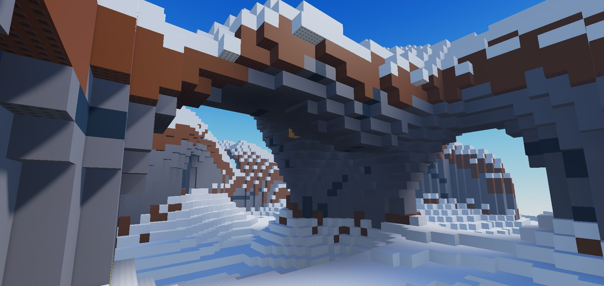
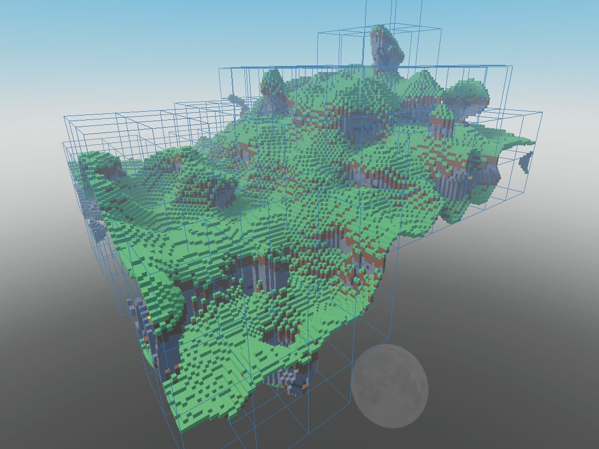
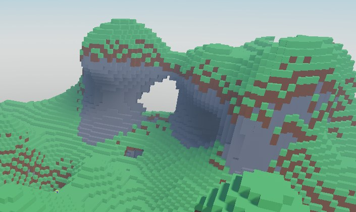
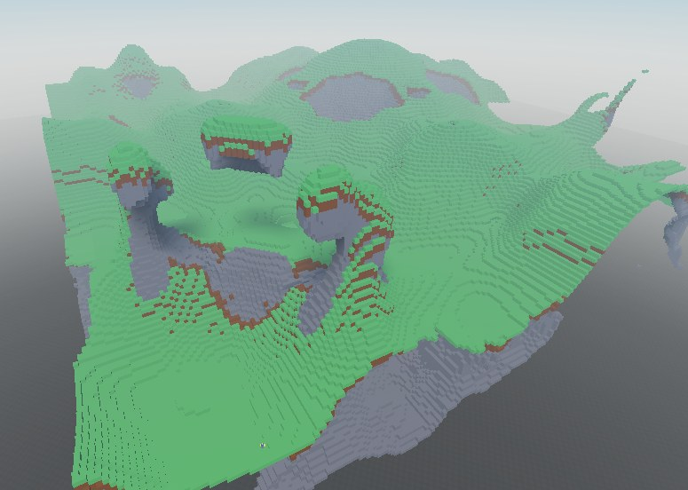
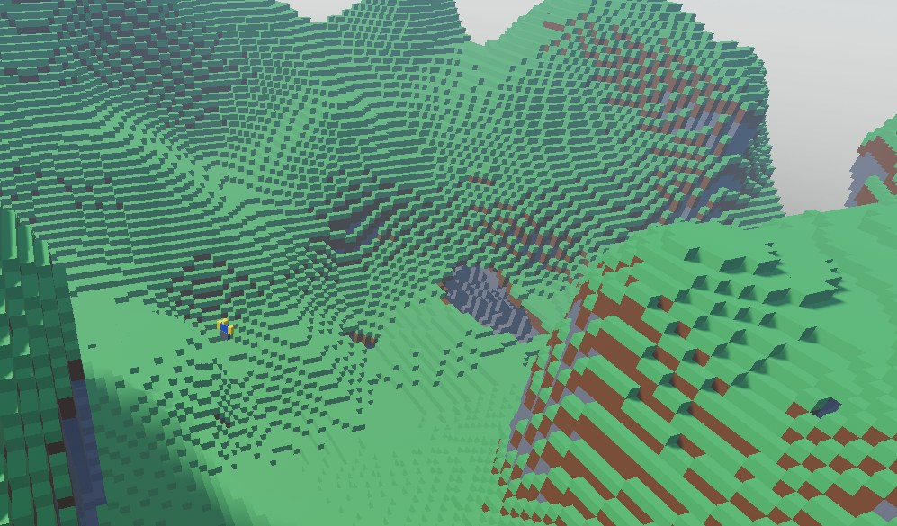
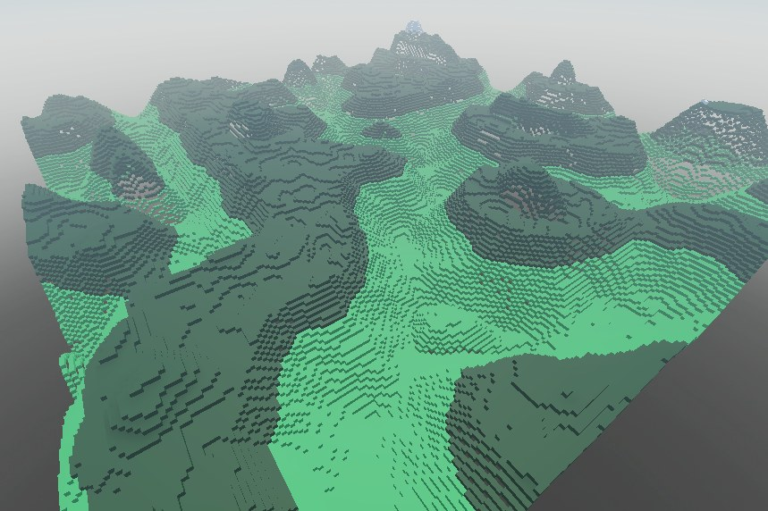
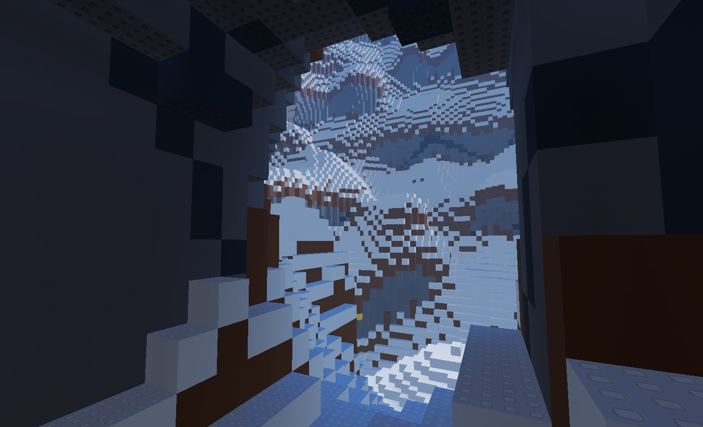
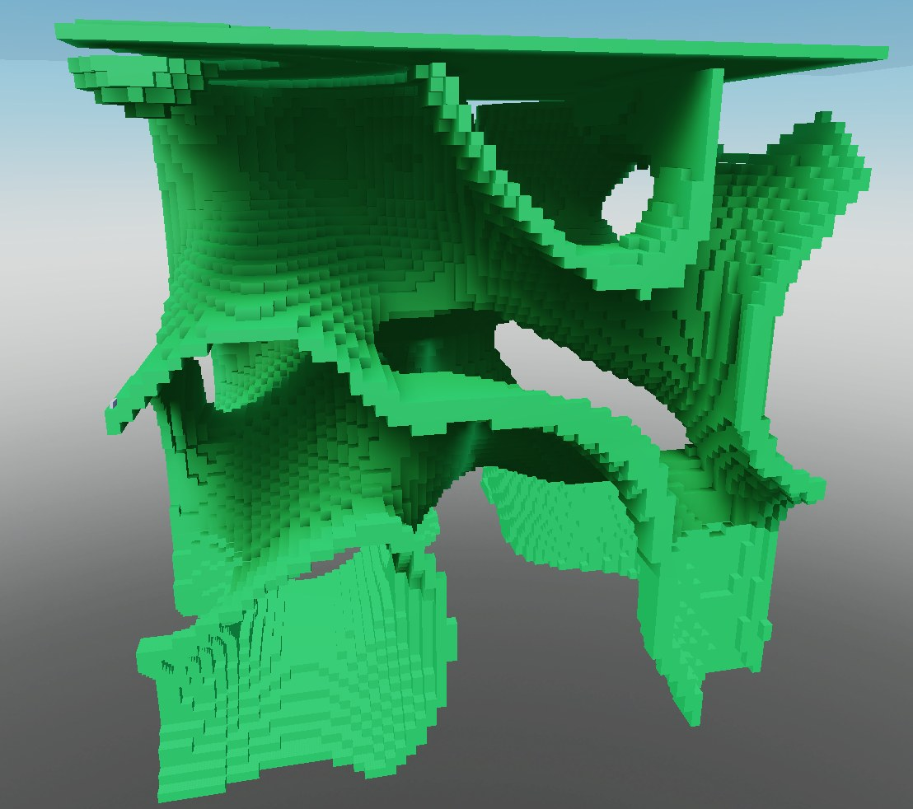
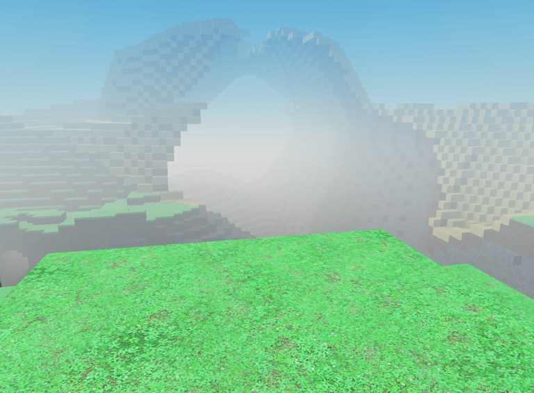

# Voxel Engine (Roblox / Luau)

**Built:** 2022 – 2023 · Solo project

> Written in Roblox Studio between 2022 and 2023. Roblox saves projects as binary place files, so in 2026 I used Claude to extract the scripts into plain `.lua` files for GitHub. The code itself is unchanged, apart from deleting a few commented-out debug prints.

A Minecraft-style voxel world engine for Roblox, built in four iterations. It generates an infinite, chunked block world on the server, streams chunks to clients, and renders them efficiently on the client.

## Highlights

- **Procedural terrain:** multi-octave fractal noise, with terrain height shaped by continentalness, erosion and peaks-and-valleys noise mapped through piecewise-linear splines (`v3/ServerStorage/Modules/GenerationService`).
- **Greedy meshing:** merges runs of identical blocks into rows, then planes, then boxes, cutting the part count Roblox has to render (`v3/StarterPlayer/StarterCharacterScripts/WorldRenderer.client.lua`).
- **Parallel chunk building:** chunk meshing is split across 16 Actors using Parallel Luau (`task.desynchronize`), so loading chunks doesn't stall the game.
- **Sparse "Tensor" structure:** an n-dimensional table that allocates its inner levels lazily, so empty space costs no memory (`v3/ReplicatedStorage/Modules/Utility/Tensor.lua`).
- **Server-to-client streaming:** the client requests chunks within its render distance; the server generates and sends them, and pushes block updates as they happen.
- **Block placing and breaking:** build and break tools that update the world grid and re-mesh only what changed.
- **Strict typing:** v4 is a rewrite in strict-mode Luau (`--!strict`) with exported types.

## Screenshots

Old screenshots from development, taken at different stages of the project.

| | |
|---|---|
|  |  |
| Chunk boundaries shown as wireframes | Cave arch carved through a hill |
|  |  |
| Floating islands and caves from 3D noise | Hills and valleys, with a player for scale |
|  |  |
| Mountains from layered noise | Looking out of a cave in the snow biome |
|  |  |
| A 3D noise test in one chunk area | Textured blocks with fog |

## Versions

| Folder | What changed |
|---|---|
| `v1` | First version: chunk system, fractal noise terrain, server request framework, player data and HUD. |
| `v2` | Faster world generation, breadth-first chunk loading, and a first move to worker threads. |
| `v3` | Main version: rebuilt renderer with greedy meshing, 16 parallel Actors, spline-shaped terrain, sparse tensor storage, build and break tools. |
| `v4` | Early strict-typed rewrite of the chunk and generation core. |

## Terrain generator experiments

Standalone prototypes in `terrain/` where I worked out the world generation and meshing ideas used in the engine.

| Folder | What it explores |
|---|---|
| `terrain/gen2` | First heightmap test: noise-based terrain built from blocks around the player. |
| `terrain/gen3` | Layered noise maps (surface, continentalness, erosion, temperature) blended with interpolation, 3D noise caves with flood-fill edge detection, chunk generation on a parallel Actor, and two maximal-rectangle tests (`testRect`, `testRect2`) for merging blocks. |
| `terrain/gen4` | Biomes (plains, desert, tundra) picked by nearest biome point, separate terrain, biome and structure generators, mining, and a dynamic-programming maximal-rectangle algorithm (`rectangle2`) for merging blocks into fewer parts. |

## Layout

The code was written in Roblox Studio and extracted from the place files. Folders mirror the Roblox Explorer tree (`ServerScriptService`, `ReplicatedStorage`, …). File suffixes follow the Rojo convention:

- `.server.lua`: server `Script`
- `.client.lua`: `LocalScript`
- `.lua`: `ModuleScript`

Only my own code is included. Third-party libraries the place files used (ProfileService, Promise, PartCache, GoodSignal, Binder, base93, WorkerThreads, HD Admin) and Roblox's default player scripts were left out, so the code won't run on its own without them.
